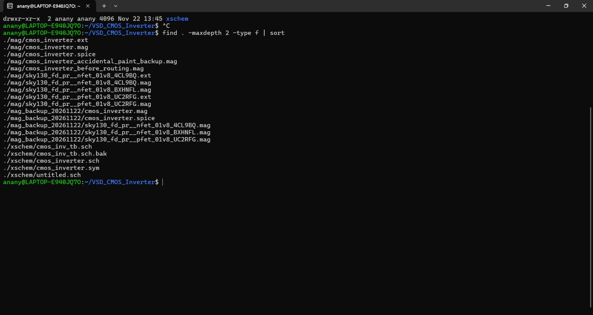
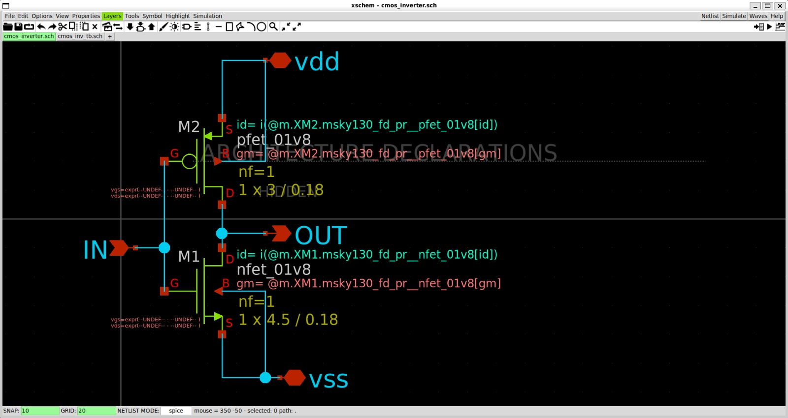
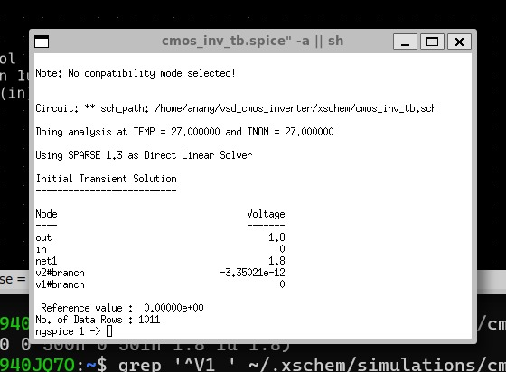
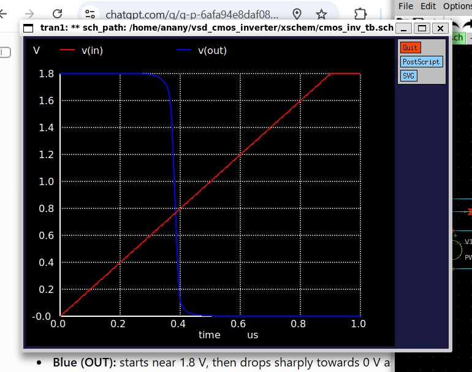

# SKY130 CMOS Inverter Design Using Xschem and Magic

A custom IC design project implementing a CMOS inverter with the SkyWater SKY130A process design kit (PDK). The project covers schematic capture, reusable symbol creation, testbench preparation, SPICE simulation, physical layout in Magic, design-rule checking (DRC), layout extraction, and layout-versus-schematic (LVS) verification.

## Project objectives

- Design a CMOS inverter using SKY130A PMOS and NMOS devices.
- Create a reusable inverter symbol in Xschem.
- Build a testbench and generate SPICE netlists.
- Simulate the inverter's transient response.
- Create the physical layout in Magic.
- Extract the layout netlist and perform DRC and LVS checks.

## Tools and technology

The development environment is Ubuntu running through WSL2 on Windows.

| Tool / technology | Purpose | Local environment |
|---|---|---|
| Ubuntu / WSL2 | Linux development environment | Ubuntu under WSL2 |
| Xschem | Schematic capture, symbol creation and SPICE netlisting | Local build under `~/opt/xschem-3.4.7/` |
| Magic | Physical layout, DRC and extraction | Local build `8.3.703` |
| Netgen | Layout-versus-schematic comparison | Local build `1.5.332` |
| ngspice | SPICE simulation | Version `45.2` |
| SkyWater SKY130A PDK | Device definitions, technology files and design rules | `/usr/local/share/pdk/sky130A/` |

Tool paths and versions describe the development machine and may need adjustment on another system. The SKY130A PDK is an external dependency and is not included in this repository.

## Design overview

A CMOS inverter consists of a PMOS pull-up transistor and an NMOS pull-down transistor. The two gates share the input signal. Their drains connect to the output. The PMOS source and bulk connect to the positive supply (VDD), while the NMOS source and bulk connect to ground (VSS).

| Device terminal | Intended net |
|---|---|
| PMOS gate | IN |
| PMOS source | VDD |
| PMOS bulk | VDD |
| PMOS drain | OUT |
| NMOS gate | IN |
| NMOS source | VSS |
| NMOS bulk | VSS |
| NMOS drain | OUT |

The transistor dimensions and finger configuration are defined in the Xschem schematic. The generated SPICE netlist is the reference for recording the exact device parameters used in a particular revision.

## Repository structure

```text
SKY130_CMOS_Inverter/
├── README.md
├── .gitignore
├── xschem/
│   ├── cmos_inverter.sch
│   ├── cmos_inverter.sym
│   └── cmos_inv_tb.sch
├── mag/
│   ├── cmos_inverter.mag
│   ├── device_cells/       # Generated SKY130 device cells used by the layout
│   ├── cmos_inverter.ext
│   └── cmos_inverter.spice
├── simulation/
│   └── results/            # Selected plots and simulation logs
├── docs/
│   └── design-notes.md
└── screenshots/            # Screenshots captured from this project
```


## Design flow

### 1. Environment and PDK setup

The project uses the SKY130A technology files with Xschem and Magic. The PDK must be installed separately and configured on the host machine.

### 2. Schematic capture in Xschem

The inverter schematic uses SKY130A PMOS and NMOS devices. The reusable symbol exposes four top-level pins: `VDD`, `IN`, `OUT`, and `VSS`. The testbench instantiates the inverter symbol and applies an input stimulus while providing the supply connections.

Project files:

- `xschem/cmos_inverter.sch` — inverter schematic
- `xschem/cmos_inverter.sym` — reusable inverter symbol
- `xschem/cmos_inv_tb.sch` — simulation testbench



### 3. SPICE netlisting and simulation



Generate the SPICE netlist from Xschem and use the testbench to run a transient simulation with ngspice. Save the netlist, simulation log, and waveform generated from the actual project in the corresponding repository folders.




### 4. Physical layout in Magic


Create the layout using the SKY130A technology. The PMOS and NMOS devices must be placed and interconnected according to the schematic, including the required well and substrate contacts. Keep the Magic layout and any generated device-cell files together so that the layout can be reopened.

### 5. DRC, extraction and LVS

Run the SKY130A design-rule checks in Magic and resolve the reported violations. Extract the layout netlist and compare it with the schematic netlist using the local Netgen LVS build. Keep the actual DRC output, extracted netlist, LVS report and screenshots as project evidence. A successful result should be reported only when the corresponding tool output confirms it.

## Reproducing the environment

Set the PDK environment variables in an Ubuntu terminal:

```bash
export PDK_ROOT=/usr/local/share/pdk
export PDK=sky130A
```

Launch Xschem with the SKY130A library configuration:

```bash
cd ~/VSD_CMOS_Inverter/xschem
~/opt/xschem-3.4.7/bin/xschem \
  --rcfile /usr/local/share/pdk/sky130A/libs.tech/xschem/xschemrc \
  cmos_inverter.sch
```

Launch Magic from the layout directory:

```bash
cd ~/VSD_CMOS_Inverter/mag
~/opt/magic-8.3.703/bin/magic -d XR
```

Use the local Netgen executable for LVS work:

```bash
~/opt/netgen-1.5.332/bin/netgen
```

The exact LVS invocation depends on the netlist paths and the SKY130A setup file used. Record the command that is actually run along with its report.


## Author

Ananya Mathapati

